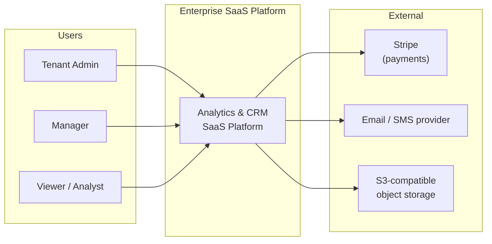
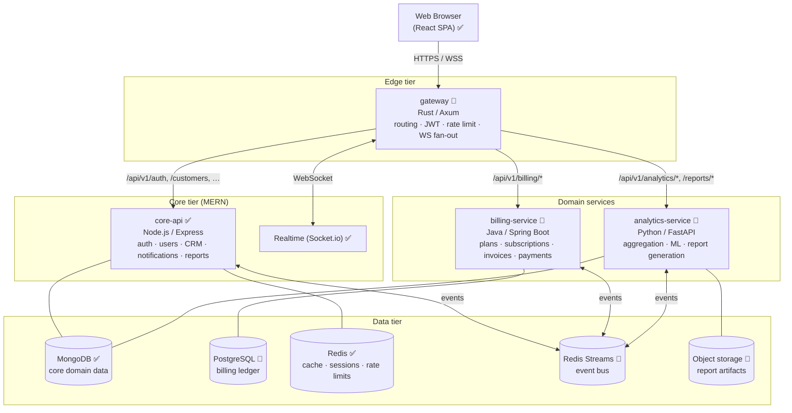
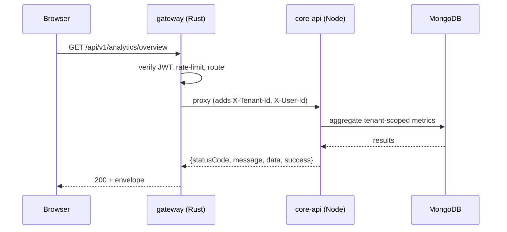
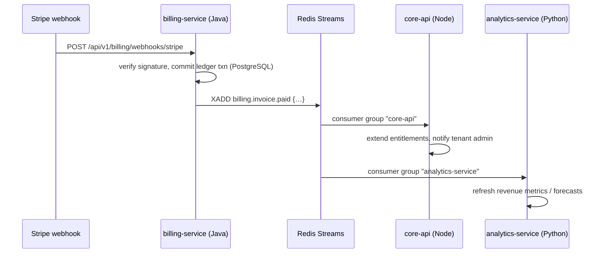

# Architecture Overview

**Status legend:** ✅ exists today · 🚧 planned (see [Roadmap](../roadmap.md))

The Enterprise SaaS Platform is a multi-tenant analytics & CRM platform. It is delivered as a **polyglot microservices system**: a MERN core (React + Node/Express + MongoDB) augmented by a Java billing service, a Python analytics/ML service, and a Rust edge gateway, all connected through a Redis Streams event bus.

Design goals, in priority order:

1. **Multi-tenant isolation** — one deployment serves many organizations safely.
2. **Correctness where it matters** — billing/ledger operations are transactional and auditable.
3. **Performance at the edge** — gateway rate-limiting, JWT verification and WebSocket fan-out are latency-critical and GC-free.
4. **Data-driven product** — analytics and ML are first-class, not bolt-ons.
5. **Operability** — every service is stateless where possible, observable, and independently deployable.

## 1. System Context (C4 Level 1)

**Actors**

| Actor | Role | Typical use |
|-------|------|-------------|
| Tenant Admin | `admin` | Organization setup, user management, billing, full data access |
| Manager | `manager` | CRM operations, reports, customer management |
| Viewer / Analyst | `viewer` | Read-only dashboards, analytics, exports |
| External systems | — | Stripe (payments), email/SMS (notifications), object storage (report artifacts) |

## 2. Containers (C4 Level 2)

> **Deployment note:** services expose REST internally; only the gateway (and, in dev, Vite) is publicly reachable. In production the SPA is served as static assets by `core-api` (already supported) or a CDN.

## 3. Key Flows

### 3.1 Synchronous query (dashboard load)

### 3.2 Asynchronous side effect (payment received)

Rules for this pattern are defined in [ADR-0005](../adr/0005-communication-patterns.md): **commands/queries go over REST; anything with cross-service side effects goes through the event bus.**

### 3.3 Realtime updates

`core-api` publishes domain events to Socket.io rooms (`tenant:<id>`); the Rust gateway maintains the WebSocket connections and fans messages out to subscribed browsers. Today Socket.io is handled directly by `core-api` ✅; the gateway takes over connection management in Phase 2 of the [roadmap](../roadmap.md).

## 4. Quality Attributes

| Attribute | Tactic | Where |
|-----------|--------|-------|
| Multi-tenancy | Tenant discriminator on every document/row; JWT carries `tenantId`; scoped queries enforced in middleware | [Data](./data-architecture.md#tenancy-model), [Security](./security.md) |
| Latency (edge) | Rust gateway: JWT verify + rate limit in <1 ms p99, no GC pauses | gateway 🚧 |
| Correctness (money) | Java + PostgreSQL transactions, double-entry ledger, immutable invoice records | billing-service 🚧 |
| Scalability | Stateless services, horizontal pods, Redis-backed rate limiting, consumer groups | [Deployment](../guides/deployment.md) |
| Resilience | Timeouts + retries + circuit breakers on outbound calls; events are at-least-once with idempotent consumers | [ADR-0005](../adr/0005-communication-patterns.md) |
| Observability | Structured logs (Winston today), OpenTelemetry traces/metrics planned, health endpoints per service | [Deployment](../guides/deployment.md#observability) |
| Security | JWT + RBAC (admin/manager/viewer), helmet, input sanitization, rate limiting, secrets in a vault | [Security](./security.md) |

## 5. Why Polyglot?

Each language is used where its ecosystem and runtime properties give a durable advantage — this is deliberate, not incidental. The allocation and its trade-offs are recorded in [ADR-0002](../adr/0002-service-technology-allocation.md):

- **JS/TS (MERN)** — product velocity for the SPA and CRUD-heavy core; one language across client/server.
- **Java (Spring Boot)** — billing: transactional integrity, mature payments/ledger ecosystem, long-term support.
- **Python (FastAPI)** — analytics/ML: pandas, scikit-learn, forecasting, report pipelines.
- **Rust (Axum)** — edge gateway: predictable sub-millisecond latency, memory safety without GC, fearless concurrency for WebSocket fan-out.

## 6. Related Documents

- [Service catalog](./services.md) — per-service detail
- [Data architecture](./data-architecture.md) — stores, schemas, tenancy
- [Security](./security.md) — authN/authZ model
- [Roadmap](../roadmap.md) — how we get from today to the target
